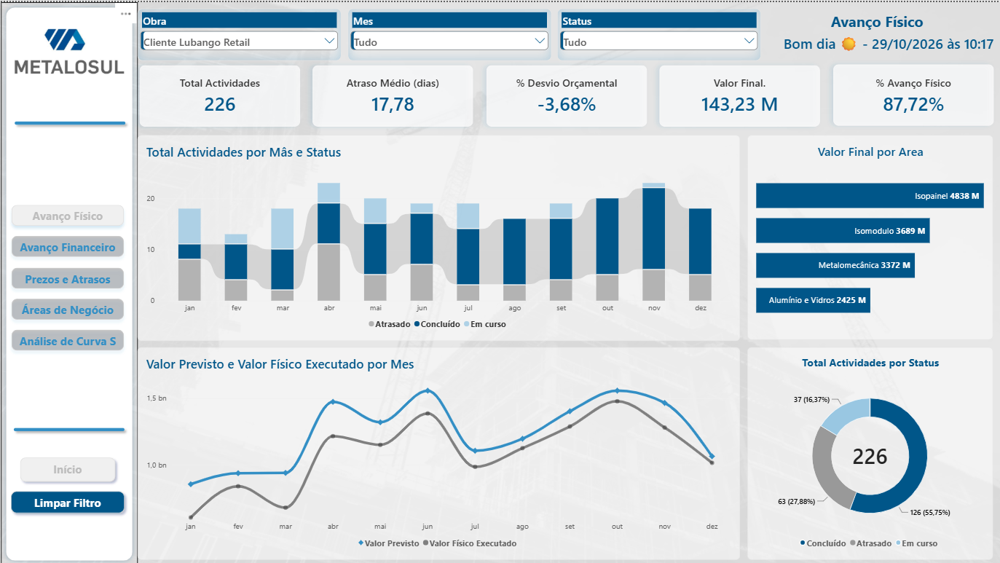
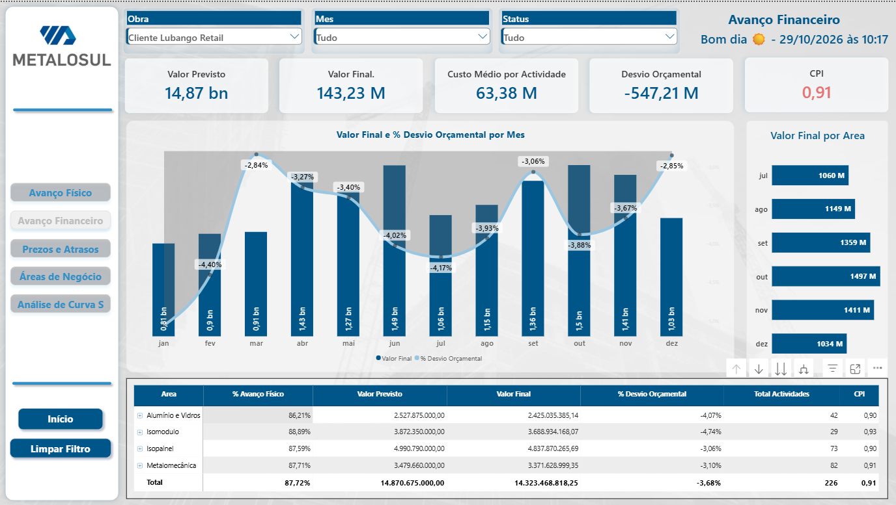
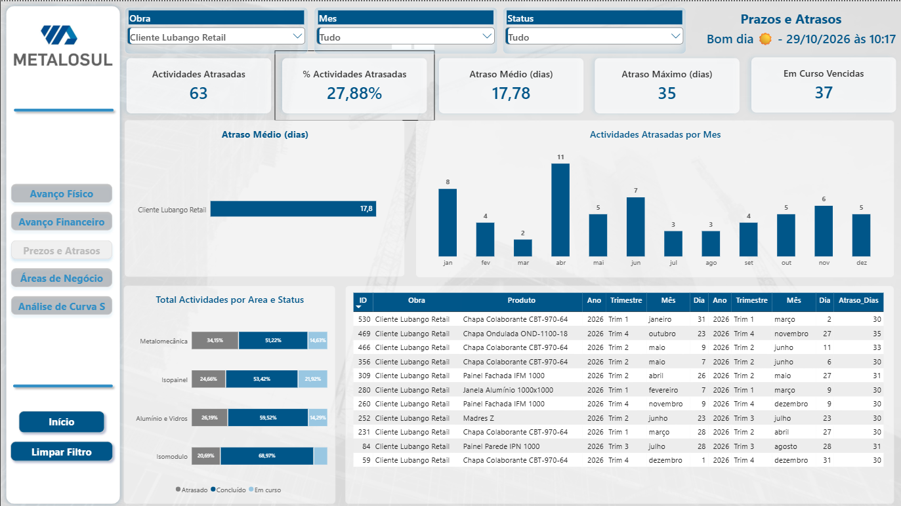
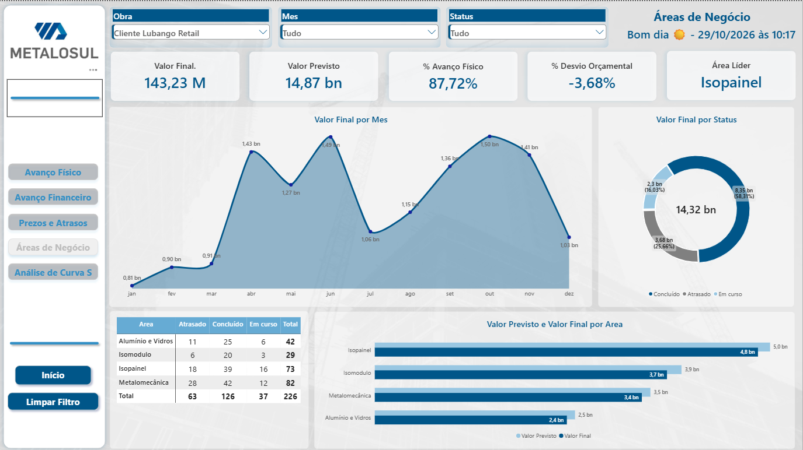
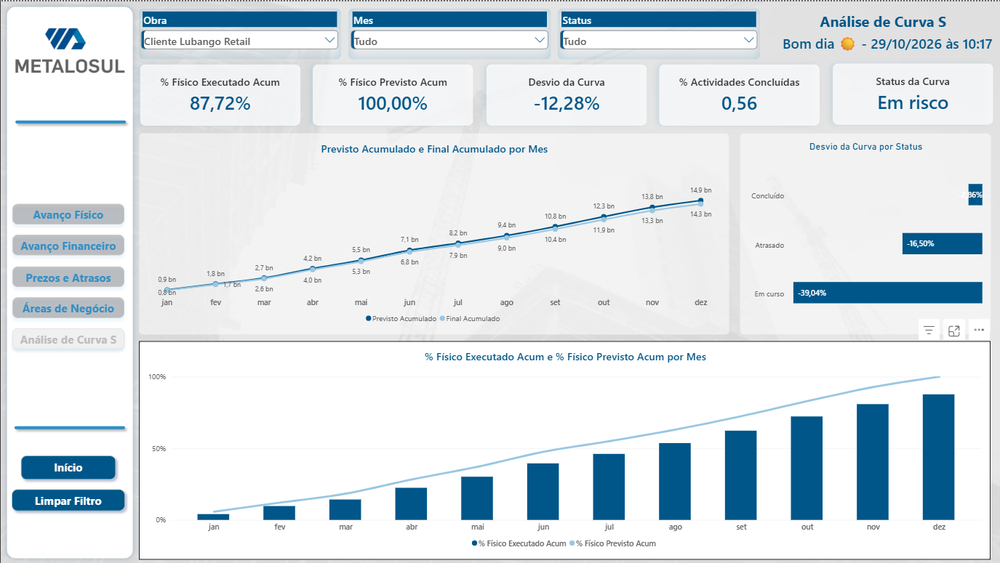

# Dashboard de Gestão e Acompanhamento de Obras — Power BI

Relatório interactivo em Microsoft Power BI para acompanhar a execução de obras de construção civil. Reúne indicadores físicos, financeiros e de prazo para apoiar o controlo operacional e a tomada de decisão.



## Conteúdo

- [Visão do relatório](docs/visao-geral.md) — objectivo, páginas e navegação.
- [Guia de utilização](docs/guia-de-utilizacao.md) — como abrir, actualizar e explorar o relatório.
- [Modelo e indicadores](docs/modelo-e-indicadores.md) — modelo analítico e significado dos principais KPIs.

## O que pode analisar

| Área | Questões respondidas |
| --- | --- |
| Avanço físico | O que foi planeado, o que foi executado e qual é o progresso da obra? |
| Avanço financeiro | Qual é o valor previsto, o valor final e o desvio de custo? |
| Prazos e atrasos | Que actividades estão atrasadas e qual é a dimensão do atraso? |
| Áreas de negócio | Como varia o desempenho por produto, área de negócio e obra? |
| Curva S | A execução acumulada acompanha o plano ao longo do tempo? |

## Pré-requisitos

- [Power BI Desktop](https://powerbi.microsoft.com/desktop/) instalado (recomendado para abrir e editar o ficheiro).
- Permissões e credenciais para as fontes de dados configuradas no relatório, caso pretenda actualizar os dados.

## Como abrir

1. Clone ou descarregue este repositório.
2. Abra [powerbi/project_v1.pbix](powerbi/project_v1.pbix) no Power BI Desktop.
3. Utilize as páginas e os filtros do relatório para explorar os resultados.
4. Para actualizar os dados, seleccione **Actualizar** no Power BI Desktop e valide as credenciais/origens quando solicitado.

> Os dados de origem não são distribuídos separadamente neste repositório. Antes de publicar ou partilhar uma versão actualizada, confirme as permissões, a confidencialidade e a actualização das fontes.

## Demonstração e capturas

Uma demonstração em vídeo está disponível em [videos/Dashboard_Apresenteção.mp4](videos/Dashboard_Apresenteção.mp4).

| Avanço financeiro | Prazos e atrasos |
| --- | --- |
|  |  |
| Áreas de negócio | Curva S |
|  |  |

## Tecnologias

- Microsoft Power BI
- DAX
- Power Query
- Modelação dimensional

## Estrutura do repositório

```text
.
├── docs/       # documentação funcional e técnica
├── images/     # capturas das páginas do relatório
├── powerbi/    # ficheiro .pbix
└── videos/     # demonstração do dashboard
```

## Autor

Albano Yuma Manuel — projecto prático de análise de dados e Business Intelligence aplicado à construção civil.
